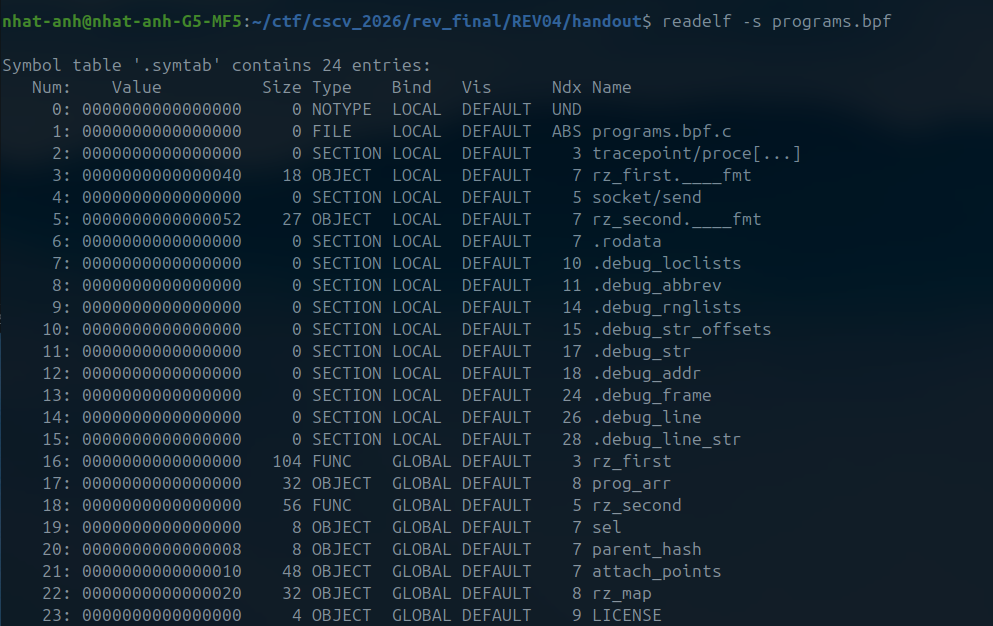
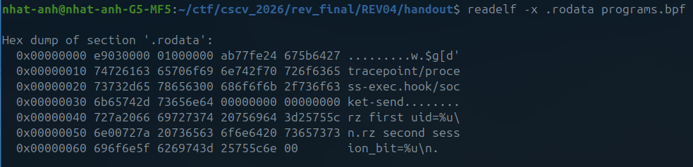
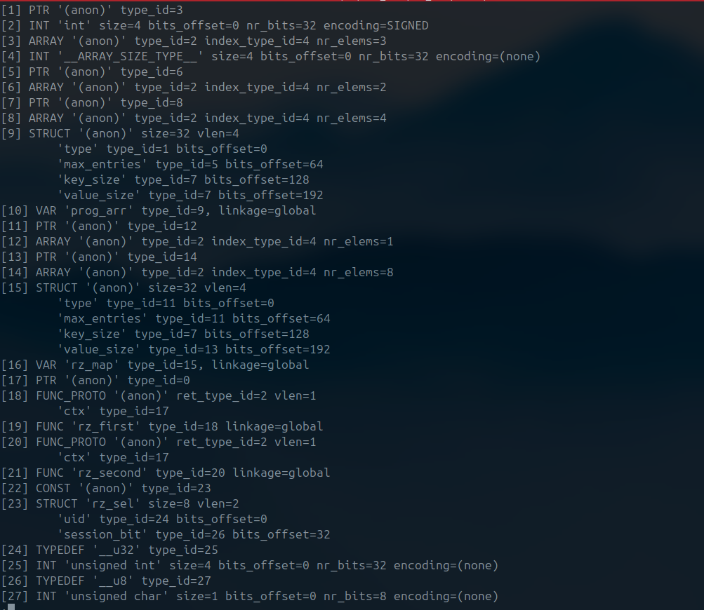
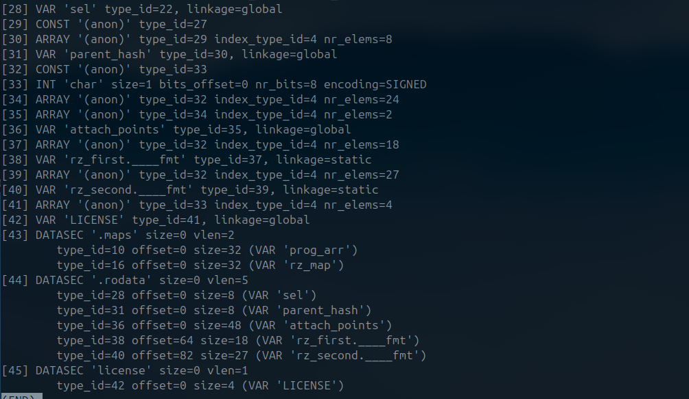
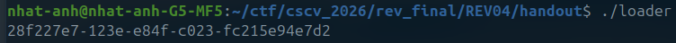
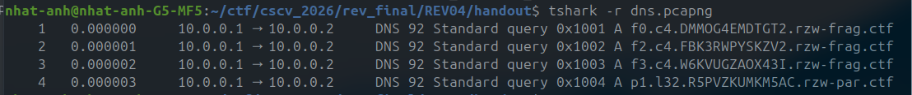
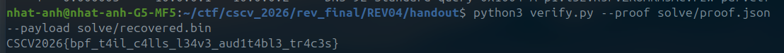

# Ring Zero Whisper

- Category : Rev 

---

Theo như description của challenge , thì file `programs.bpf` trong chal chính là 1 rookit , khi được `loader` load vào kernel thì các eBPF programs sẽ hook vào ( trực chờ) các SSH session , lấy dữ liệu từ chúng , sau đó exfiltrate dữ liệu đó qua các DNS query ( các lệnh SSH session khớp 1 số tiêu chí nhất định)

- >eBPF  là một công nghệ mang tính cách mạng cho phép chạy các chương trình tuỳ biến  trực tiếp bên trong nhân Linux mà không cần phải thay đổi mã nguồn kernel .Chương trình eBPF được viết ở userspace, sau đó được biên dịch thành bytecode và đưa vào kernel. Trước khi chạy, nhân Linux sẽ thông qua một verifier rất nghiêm ngặt để đảm bảo mã này an toàn (không gây treo máy, truy cập vùng nhớ trái phép)

  >Hiệu năng cao, an toàn và linh hoạt vì có thể hook vào các vị trí như syscall, tracepoint, kprobe mà không làm sập hệ thống => dùng để quan sát hệ thống , theo dõi hiệu năng , bảo mật và tối ưu mạng

  >Mặc dù eBPF được thiết kế với các cơ chế bảo mật (như verifier), hacker vẫn có thể lạm dụng  nó để ẩn mình và thao túng hệ thống vì eBPF chạy trực tiếp và có quyền năng lớn trong kernel:

- Cách nộp :
  ```bash
  verify.py --proof proof.json --payload recovered.bin
  ```
  - Có nghĩa là chúng ta sẽ phải tìm `proof.json` và `recovered.bin` để nộp cho verify.py để nó decrypt `flag.enc` và nhả về  flag

- FORMAT.md mà challenge cho chính là hướng dẫn để ta recover lại `proof.json` và `recovered.bin`

## verify.py 
Trước tiên ta sẽ đọc verify.py 
- Input :  proof.json (proof) + recovered.bin ( payload)
- Output : flag nếu proof và payload chuẩn 

**Logic:**
Từ proof + payload → derive 1 key (32 byte) -> Dùng key đó để verify + decrypt flag.enc => flag

- **In detail**

  ```python
  def _canon(obj):
      return json.dumps(obj, ensure_ascii=False, sort_keys=True, separators=(",", ":")).encode()
  ```
- Biến proof.json thành một chuỗi byte duy nhất, xác định

  
  ```python
  def _commit(proof, payload):
      c = _canon(proof)
      if payload is not None:
          c += b"|" + hashlib.sha256(payload).digest()
      return c
  ```
- Nối hash của payload vào proof để tạo thành commit 

  ```python
  def _key(c):
      prk = hmac.new(b"CSCV2026:extract", c, hashlib.sha256).digest()
      return hmac.new(prk, b"CSCV2026:v2", hashlib.sha256).digest()
  ```
- derive key từ commit dùng HKDF 
    - ```
      Bước 1 (extract):
          prk = HMAC-SHA256(key = b"CSCV2026:extract",msg = commit)          → 32 byte

      Bước 2 (expand):
          key = HMAC-SHA256(key = prk,msg = b"CSCV2026:v2")              → 32 byte
      ```
  ```python
  def _open_flag(flag_path, proof, payload=None):
      # Mở file flag.enc
      lines = Path(flag_path).read_bytes().splitlines()
      if not lines or lines[0] != b"CSCV-ENC-2":
          return None

      # Format flag.enc Line 1: CSCV-ENC-2
      #                 Line 2: <base64(nonce || tag || ct)>    ← payload đã mã hóa
      # tách lấy nonce , tag , ct 
      raw = base64.b64decode(lines[1])
      nonce, tag, ct = raw[:16], raw[16:48], raw[48:]

      # tạo verify key k từ commit (gồm proff , payload)
      # expected_tag = HMAC-SHA256(key = k, msg = nonce || ct)
      # if expected_tag != tag_from_file:
      #       → return None  (invalid proof)
      k = _key(_commit(proof, payload))
      if not hmac.compare_digest(hmac.new(k, nonce + ct, hashlib.sha256).digest(), tag):
          return None

      # decrypt flag bằng hmac ctr ( tự chế) với cái key tạo dc ( nếu key qua verify)
      out = bytearray()
      for i in range(0, len(ct), 32):
          ks = hmac.new(k, nonce + (i // 32).to_bytes(8, "big"), hashlib.sha256).digest()
          out += bytes(a ^ b for a, b in zip(ct[i:i + 32], ks))
      return bytes(out).decode()
  ```

- Tạo key từ payload và proof.json 
- verify key đó chính là key để decrypt flag bằng cách tính và so sánh với real tag  
- Nếu pass thì dùng key để decrypt flag 

  ```python
  import argparse
  p = argparse.ArgumentParser(); p.add_argument("--proof"); p.add_argument("--payload"); a = p.parse_args()
  proof = json.load(open(a.proof, encoding="utf-8")); payload = open(a.payload, "rb").read()

  flag = _open_flag(str(Path(__file__).parent / 'flag.enc'), proof, payload)
  if flag is None:
      sys.stderr.write('invalid proof\n')
      raise SystemExit(1)
  sys.stdout.write(flag + '\n')
  ```
=> Nhiệm vụ là phải tìm ra payload và proof đúng để mà đưa vào `verify.py` để decrypt ra flag


## FORMAT.md

nội dung trong file FORMAT.md chính là chỉ dẫn cách ta có được recovered.bin(payload) và proof.json (proof)

## proof.json 

Các field trong proof.json 

- >proof.json fields: attach_points, prog_chain, map_ids, uid, parent_hash, session_bit. 


programs.bpf  sẽ cho ta vài field của proof.json nằm trong section `.rodata`  . Ta sẽ đọc cả `BTF`  và `symtab` để biết bố cục các biến selector và offset ( vị trí) của các biến

- >programs.bpf = eBPF object thật (ELF, clang -target bpf). Selector tuple nằm trong `.rodata` const: đọc bằng pyelftools — BTF xác định tập biến selector + bố cục kiểu (sel/parent_hash/attach_points thuộc datasec .rodata), còn *offset* trong `.rodata` lấy từ ELF symbol table (st_value = offset section). 

- >Lưu ý: clang BTF datasec offset cho global luôn bằng 0 ở object level — dùng `readelf -s` + `readelf -x .rodata`

- >`parent_hash` lưu dạng RAW 8 BYTE (không phải chuỗi ASCII) — đọc 8 byte rồi `.hex()` để lấy chuỗi 16 hex đáp án; `sel` = struct {u32 uid; u8 session_bit}.


Giá trị các field nằm trong `.rodata` , tuy nhiên ta cần xem `.symtab` để biết vị trí các biến bên trong `.rodata`

- 

ta thấy được 3 object ( biến) có lẽ là tcần thiết trong guide ở section 7 ( .rodata)

- ```bash
    19: 0000000000000000     8 OBJECT  GLOBAL DEFAULT    7 sel
      20: 0000000000000008     8 OBJECT  GLOBAL DEFAULT    7 parent_hash
      21: 0000000000000010    48 OBJECT  GLOBAL DEFAULT    7 attach_points
  ```
Ta đã biết offset của các biến cần thiết trong `.rodata` , giờ là đọc chúng 



- `sel` ofset 0  , 8 bytes => `e9030000 01000000`
- `parent_hash` offset 8 , 8 bytes => `ab77fe24 675b6427`
- `attach_points` offset 16 , 48 bytes => `74726163 65706f69 6e742f70 726f6365 73732d65 78656300 686f6f6b 2f736f63 6b65742d 73656e64 00000000 00000000`

Ta đã có dữ liệu thô, tuy nhiên ta cần biết kiểu dữ liệu , trong guide có nói BTF xác định tập biến selector + bố cục kiểu , ta sẽ xem `.BTF` bằng btftool 

```bash
nhat-anh@nhat-anh-G5-MF5:~/ctf/cscv_2026/rev_final/REV04/handout$ bpftool btf dump file programs.bpf format raw | less
```




sau khi chain ta thấy được rằng 

- `sel` là 1 struct gồm :
    - `uid` : unsigned int 32 bit từ offset 0 trong `sel` => `1001`
    - `session bit` : unsigned char 8 bit từ offset 32 trong `sel` => `1`

- `parent_hash` là 1 arry gồm 8 unsigned char (8 bytes raw) => `"ab77fe24675b6427"`

- `attached_point` là 1 array 2 chiều [[...],[....]] với mỗi mảng con gồm 24 char ( fixed 24 bytes) => `["tracepoint/process-exec", "hook/socket-send"]`


Ta được 1 số field của proof.json 
```json
"attach_points": ["tracepoint/process-exec", "hook/socket-send"],
"parent_hash": "ab77fe24675b6427",
"session_bit": 1,
"uid": 1001
```

**Phần tiếp theo của gợi ý**
- > map_ids/prog_id come from bpftool.json.

`Prog_ids` ở đây chính là các program trong eBPF , ta có thể thấy nó chính là 2 FUNC `rz_first` và `rz_second` duy nhất trong file . Khi chạy programs.bpf , các program này sẽ được kernel cấp cho id . Tail call đến program sau chính là nhảy sang thực thi program đó . 

Các program eBPF  khi chạy trong Kernel bị cấm sử dụng biến toàn cục (mọi thứ sẽ bị xóa sạch sau khi chạy xong) . Vậy nên ta cần eBPF Map giống như một bảng tin chung nằm trong Kernel , Các chương trình user-space (như loader) cũng có thể đọc/ghi vào map

  - rz_first viết dữ liệu lên Bảng tin.
  - rz_second đọc dữ liệu từ Bảng tin.

Và khi mà programs.bpf chạy thì kernel sẽ cấp phát cho mỗi map 1 id 

=> Ta có thể hiểu bpftool.json là 1 tệp mà ghi lại các id của programs , maps trong runtime chạy `programs.bpf` 
- ```json
  {
    "programs": [
      {
        "id": 41,
        "map_ids": [
          7
        ],
        "tail_call": 42
      },
      {
        "id": 42, 
        "map_ids": [
          7
        ],
        "tail_call": null
      }
    ],
    "maps": [
      {
        "id": 7,
        "name": "map_7"
      }
    ]
  }
  ```

ta dễ dàng thấy 
- ```json
  prog_chain : [41,42]
  map_ids : [7]
  ```


Như vậy là ta đã có bản hoàn chính của proof.json
- ```json
  {
    "attach_points": [
      "tracepoint/process-exec",
      "hook/socket-send"
    ],
    "map_ids": [
      7
    ],
    "parent_hash": "ab77fe24675b6427",
    "prog_chain": [
      41,
      42
    ],
    "session_bit": 1,
    "uid": 1001
  }
  ```

## Recovered.bin (payload)

trong fiel `FORMAT.md` cũng đã guide về payload 

   -    >recovered.bin = the recovered stream bytes.

        > The loader prints the boot id; run it.

        >Recover the stream: `dns.pcapng` is a REAL capture — parse the DNS queries; each QNAME carries a fragment label `f<seq>.c<count>.<base32>.rzw-frag.ctf` or the parity label `p<miss>.l<len>.<base32>.rzw-par.ctf`; Base32-decode each label, repair the erased fragment from parity (XOR erasure), concatenate in sequence order, then XOR-decrypt.

        >Stream key = SHA-256(canonical JSON of {uid, session_bit, parent_hash} + boot-id); keystream block i = SHA-256(key || i as 4-byte big-endian)

        >payload = cipher XOR keystream. 

        >Write the payload bytes to recovered.bin

Có thể đoán được rằng `recovered.bin` chính là data bị rookit này nghe lén qua các SSH session và exfiltrate ra . Nó được encrypt , sau đó phân mảnh ra rồi đưa vào các DNS quert để gửi 
Đầu tiên chạy loader và ta sẽ có bootid 



Thường thì boot id thay đổi sau mỗi lần load , nhưn có vẻ tác giả đã hardcode vào `loader` `boot_id = 28f227e7-123e-e84f-c023-fc215e94e7d2`

Tiếp theo ta sẽ xem các package trong `dns.pcapng`

- 

-  Từ nội dung trên ta thấy được 3 fragment label ( base32 encoded) là 
    - `DMMOG4EMDTGT2`
    - `FBK3RWPYSKZV2`
    - `W6KVUGZAOX43I`

- và parity label 
  - `R5PVZKUMKM5AC`

Tiếp theo , việc ta cần là làm theo hướng dẫn dể recover lại recovered.bin 

```python
import base64
import hashlib
import json
from pathlib import Path


# Khai báo các chuỗi Base32 nhận được từ DNS query
fragment_labels = [
    "DMMOG4EMDTGT2",
    "FBK3RWPYSKZV2",
    "W6KVUGZAOX43I"
]
parity_label = "R5PVZKUMKM5AC"

# decode base32 thành bytes 
def decode_base32(b32_str):
    b32_str = b32_str.upper()
    missing_padding = len(b32_str) % 8
    if missing_padding:
        b32_str += '=' * (8 - missing_padding)
    return base64.b32decode(b32_str)

decoded_fragments = [decode_base32(frag) for frag in fragment_labels]
decoded_parity = decode_base32(parity_label)


# Khôi phục mảnh bị thiếu (XOR Erasure Repair)
block_size = len(decoded_parity)
erased_fragment = bytearray(block_size)

for i in range(block_size):
    xor_value = decoded_parity[i]
    for frag in decoded_fragments:
        xor_value ^= frag[i]
    erased_fragment[i] = xor_value

erased_fragment = bytes(erased_fragment)


# Nối các mảnh label lại thành 32 bytes , đây chính là recovered.bin được encrypt
all_fragments = [decoded_fragments[0], erased_fragment, decoded_fragments[1], decoded_fragments[2]]

cipher = b"".join(all_fragments)


# gen key theo công thức 
uid = 1001
session_bit = 1
parent_hash = "ab77fe24675b6427"
boot_id = b"28f227e7-123e-e84f-c023-fc215e94e7d2"

data = {"uid": uid, "session_bit": session_bit, "parent_hash": parent_hash}
canonical_json = json.dumps(data, ensure_ascii=False, sort_keys=True, separators=(",", ":")).encode()

key = hashlib.sha256(canonical_json + boot_id).digest()

# Từ key gen keystream (counter mode)
keystream = b""
i = 0
while len(keystream) < len(cipher):
    counter_bytes = i.to_bytes(4, "big")
    block = hashlib.sha256(key + counter_bytes).digest()
    keystream += block
    i += 1

keystream = keystream[:len(cipher)]


# XOR cipher vs keystream để decrypt ra recovered.bin
payload = bytes(c ^ k for c, k in zip(cipher, keystream))

Path("/home/nhat-anh/ctf/cscv_2026/rev_final/REV04/handout/sovle/recovered.bin").write_bytes(payload)
print("Đã ghi payload ra file 'recovered.bin'")
```


## Achieve flag 

bước cuối cùng , ta chỉ cần nộp proof và payload ta đã lấy được để lấy flag




# Reverse 

Như vậy là ta đã lấy được flag , tuy nhiên tôi muốn hệ thống lại logic của challegne này . Như trong description thì yêu cầu của challenge là `Xác định quy tắc chọn lệnh, khôi phục dữ liệu đã bị truyền đi, và chứng minh toàn bộ chuỗi hoạt động` . Ta sẽ tìm hiểu thông suốt luồng hoạt động của chal 

Đầu tiên `programs.bpf` chính là 1 rookit eBPF của attacker . Rookit này sẽ được máy của nạn nhân load vào kernel bởi `loader` với `boot_id : 28f227e7-123e-e84f-c023-fc215e94e7d2`


Tiếp theo thì rookit này sẽ bắt lấy , ghi lại data của 1 số SSH session và exfiltrate qua DNS query . Cụ thể :

- Hook đến 2 attach point của hệ thống là `"tracepoint/process-exec"` ( khi thực hiện 1 tiến trình) và `"hook/socket-send"` (khi gửi tin qua socket) .Có thể thấy 2 cái attach point này là của 1 programs chain `rz_first` và `r2_second` => Khi gặp event `process-exec` rồi `socket-send` , nếu thỏa mãn điều kiện chọn lệnh , ghi lại dữ liệu của phiên đó , sau đó exfiltrate dữ liệu đó

- Về quy tắc chọn lệnh , file `programs.bpf` rất nhẹ và chỉ là 1 cái vỏ rỗng ( ko có nội dung trong 2 program con) để ta đọc các data r giải chal ( ko cần rev) . Tuy nhiên thì ta có thể đoán được các quy tắc gắn với 3 field trong `proof.json` 
  - `parent_hash` : có thể hash của process cha
  - `session_bit` : có thể là bit phân lọai session SSH 
  - `uid` : có thể là user ID 


- Về việc tuồn dữ liệu `recovered.bin` . Đầu tiên thì Rootkit dùng `{uid, session_bit, parent_hash} + boot_id` để tạo key stream rồi mã hóa (XOR) dữ liệu trộm được thành Cipher . Cuối cùng là rootkit phân mảnh nó thành 4 fragment ,tính toán thêm 1 mảnh Parity, rồi gửi chúng đi qua các tDNS query. Kẻ tấn công ở bên ngoài hứng được đống DNS này và ghép lại được `recovered.bin`

Đó chính là toàn bộ logic của việc attacker dùng rootkit eBPF để exfiltrate dữ liệu máy nạn nhân . Cuối cùng cùng về việc chứng minh toàn bộ chuỗi hoạt động , Tác giải chal cho file `verify.py` để decrypt flag . Điều này chắc chắn rằng ta đã biết dc `proof.json` : các manh mối để rev lại logic , quy tắc chọn lệnh và tham số sinh khóa để decrypt được ra `recovered.bin`